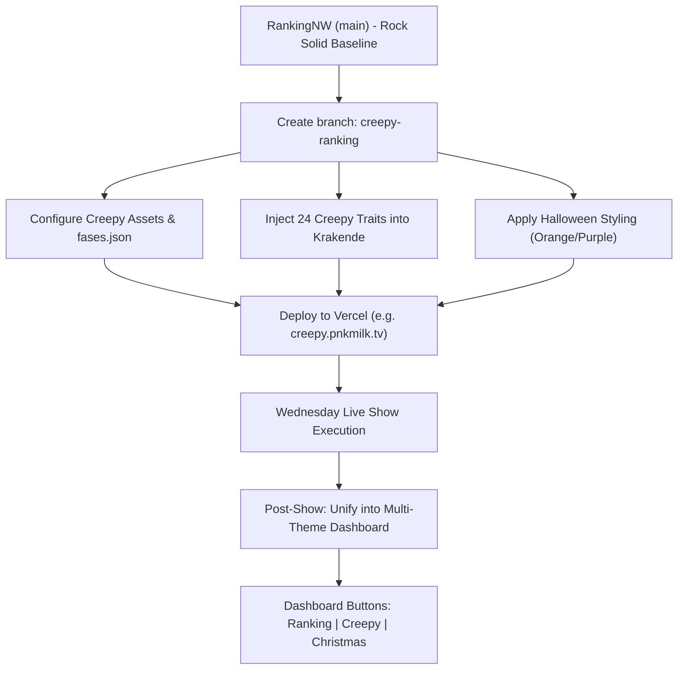

# Creepy Ranking Show (Halloween Edition) — Transition & Handoff Plan

## 1. Executive Summary & Goals

* **Target Date**: Wednesday Booking (Creepy Ranking Show).
* **Objective**: Transform 90% of the completed **RankingNW** engine into the **Creepy Ranking Show** (Halloween version) with maximum safety and zero risk to the standard Ranking codebase.
* **Two-Stage Approach**:
  1. **Stage 1 (Immediate / For Wednesday)**: Work on a dedicated branch (`creepy-ranking`) to ensure a rock-solid, isolated deployment for Wednesday's live show.
  2. **Stage 2 (Post-Wednesday)**: Merge the Halloween edition into a unified multi-show engine with a dashboard button selector (`Ranking | Creepy Ranking | Christmas Ranking`) on `pnkmilk.db`.

---

## 2. Architecture & Handoff Audit

### 2.1 The Unchanged Core (90% Engine)
These systems require **zero changes** and are inherited directly from RankingNW:
* **PocketBase Sync**: Real-time subscriptions for phase changes, voting submissions, and scores.
* **Presenter Interface**: Phase navigation, reveal triggers, timer controls, player management.
* **Display Interface (Beamer/TV)**: Phase layouts, podium animations, word clouds, charts.
* **Player Interface (Mobile)**: PIN entry, team selection, interactive voting buttons, live results.
* **Scoring & Elimination**: Point calculations and ranking tally logic.

### 2.2 The Custom Elements (10% Skin & Content)
The differences are strictly isolated to:
1. **Fases / Headings & Questions**:
   * Zitten en Staan spooky dilemmas.
   * Top 3 creepy categories.
   * Top 10 Halloween prompts.
2. **Krakende Karakters Traits**:
   * Sourced directly from `public/Creepy ranking 24.pdf`:
     * **24 Griezelig Goede Eigenschappen** (Positive traits).
     * **24 Minder Goede Eigenschappen** (Negative traits).
3. **Media & Assets**:
   * Top 3 (`public/pics/Top3 Haloween/`: Dracula, Frankenstein, Ghost, Zombie, Mummy, etc.).
   * Top 10 (`public/pics/Top10Haloween/`: Hannibal, Selfie Monster, 40 Days, etc.).
   * Trailers (`public/pics/HaloweenTrailer/`: `trailercreepy.m4v`, `top 3.m4v`).
   * Finale (`public/pics/End Haloween/`).
4. **Visual Theme & Audio**:
   * Halloween color scheme (dark black/slate `#0f0f12`, pumpkin orange `#ff7518`, neon purple `#9333ea`).
   * Spooky logo & header card.
   * Creepy endcard audio and sfx (`public/endgame/sfx/`).

---

## 3. Game Flow Comparison

| Phase Group | Standard RankingNW | Creepy Ranking Show |
| :--- | :--- | :--- |
| **01 Intro** | Ranking trailer, standard team names | Creepy intro trailer, spooky team names/yells |
| **07 Zitten & Staan** | Everyday dilemmas & habits | Halloween & scary habits / creepy dilemmas |
| **10 De Top 3** | Andes, Crypto, Geheim, etc. | Dracula, Frankenstein, Werewolf, Witch, Zombie, Mummy |
| **13 Krakende Karakters**| Standard positive/negative traits | 24 Griezelig Goede & 24 Minder Goede traits (from PDF) |
| **17 Top 10** | Standard 10 cards | Halloween 10 cards (Hannibal, Selfie Monster, etc.) |
| **20 De Finale** | Standard finale reveal & video | Creepy finale endcards (`public/pics/End Haloween/`) |

---

## 4. Rollout Strategy

---

## 5. Risk Assessment & Safety Guardrails

| Risk | Impact | Mitigation |
| :--- | :--- | :--- |
| Breaking regular RankingNW before Wednesday | High | Work on isolated `creepy-ranking` branch. No production code on `main` is touched. |
| Missing Halloween media links | Medium | Verify all paths in `pocketbase.ts` against files in `public/pics/`. |
| PocketBase schema conflicts | Low | Session format stays compatible; only session name / theme indicator is passed. |
| Presentation timing lag | Low | Pre-load videos and images locally / in CDN cache before the live event. |
